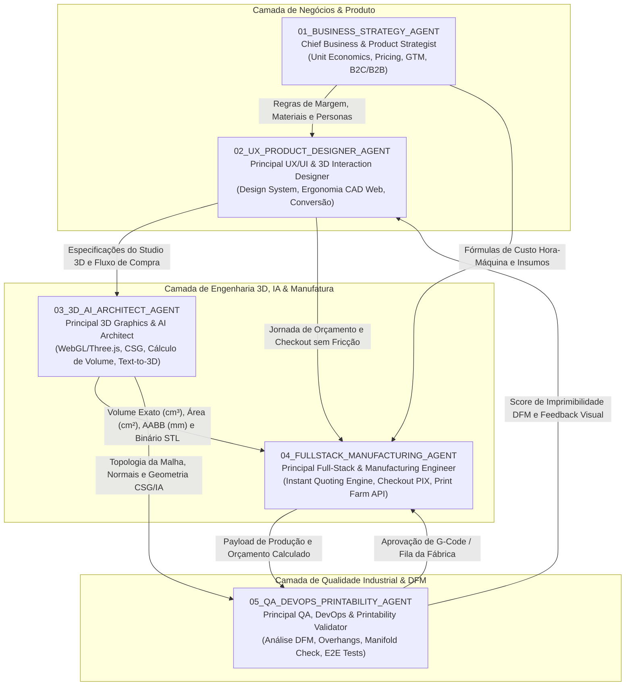
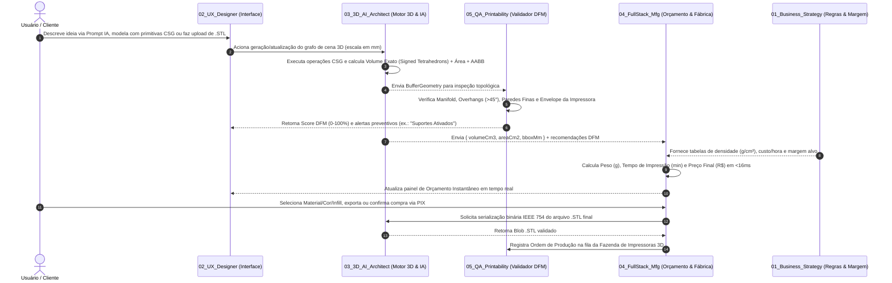

# Manifesto Geral do Time de Agentes da POLIGON (`00_POLIGON_TEAM_MANIFEST`)

> **Visão da POLIGON:** Democratizar a manufatura aditiva no Brasil e no mundo por meio de uma plataforma web integrada onde qualquer pessoa ou empresa pode **desenhar em 3D no navegador**, **gerar modelos 3D com Inteligência Artificial**, **fazer upload de arquivos técnicos (STL/OBJ)**, receber **orçamento industrial instantâneo baseado na geometria exata** e **receber a peça física impressa em casa ou na empresa**.

---

## 1. Organograma da Squad Multi-Agente POLIGON

O ecossistema de engenharia e produto da POLIGON é operado por **5 Agentes Especialistas** altamente coesos, cobrindo de ponta a ponta desde a estratégia de negócios até a validação geométrica para o chão de fábrica:

---

## 2. Catálogo dos 5 Agentes Especialistas

| ID | Arquivo de Perfil | Papel Principal | Entregáveis Chave |
| :---: | :--- | :--- | :--- |
| **01** | [`01_PRODUCT_BUSINESS_AGENT.md`](file:///c:/Users/Longaresi/Documents/PROJETO%20POLIGON/agents/01_PRODUCT_BUSINESS_AGENT.md) | **Estratégia, Negócios & Precificação** | Modelo de negócios, Unit Economics (CAC/LTV), tabelas de margem por material (PLA, PETG, ABS, Resina 8K, Nylon SLS), estratégia Go-To-Market. |
| **02** | [`02_UX_UI_DESIGN_AGENT.md`](file:///c:/Users/Longaresi/Documents/PROJETO%20POLIGON/agents/02_UX_UI_DESIGN_AGENT.md) | **UX/UI Design & Experiência 3D** | Design System Industrial Dark/Light, interface do Studio 3D acessível para leigos e precisa para engenheiros, jornada de cotação em 1 clique. |
| **03** | [`03_3D_AI_ARCHITECT_AGENT.md`](file:///c:/Users/Longaresi/Documents/PROJETO%20POLIGON/agents/03_3D_AI_ARCHITECT_AGENT.md) | **Arquitetura 3D WebGL & IA Generativa** | Viewport Three.js/R3F, modelador CSG booleano, cálculo matemático de volume via tetraedros assinados ($\text{cm}^3$), pipeline Text/Image-to-3D, exportador `.STL`. |
| **04** | [`04_FULLSTACK_MANUFACTURING_AGENT.md`](file:///c:/Users/Longaresi/Documents/PROJETO%20POLIGON/agents/04_FULLSTACK_MANUFACTURING_AGENT.md) | **Engenharia Full-Stack & Fábrica** | Motor de cotação instantânea, carrinho multi-peças, checkout PIX/Cartão, geração de Ordem de Manufatura e integração com Print Farm. |
| **05** | [`05_QA_DEVOPS_PRINTABILITY_AGENT.md`](file:///c:/Users/Longaresi/Documents/PROJETO%20POLIGON/agents/05_QA_DEVOPS_PRINTABILITY_AGENT.md) | **QA, DevOps & Validador DFM** | Análise de imprimibilidade 3D (malha fechada, overhangs $>45^\circ$, paredes finas, volume de impressão), suíte de testes matemáticos e CI/CD. |

---

## 3. Fluxo de Trabalho Ágil e Colaboração Contínua (End-to-End Workflow)

---

## 4. Como Acionar Cada Agente (Guia de Prompts e Comandos)

Para evoluir qualquer módulo da plataforma POLIGON, utilize o perfil correspondente como contexto principal:

### 4.1. Para evoluir a Precificação, Catálogo de Materiais ou Estratégia Comercial
- **Agente:** `01_BUSINESS_STRATEGY_AGENT`
- **Exemplo de Acionamento:**
  > *"Atue como o `01_BUSINESS_STRATEGY_AGENT`. Recalibre a curva de descontos B2B para pedidos acima de 100 unidades em Nylon PA12 SLS considerando redução de 40% no custo de setup."*

### 4.2. Para criar novas telas, melhorar a usabilidade do Editor 3D ou aumentar conversão
- **Agente:** `02_UX_PRODUCT_DESIGNER_AGENT`
- **Exemplo de Acionamento:**
  > *"Atue como o `02_UX_PRODUCT_DESIGNER_AGENT`. Desenhe o componente visual de comparação interativa de acabamento de camada (0.28mm Draft vs 0.12mm Alta Precisão vs 0.05mm Resina 8K)."*

### 4.3. Para novas ferramentas de modelagem 3D, Shaders, CSG ou IA Generativa 3D
- **Agente:** `03_3D_AI_ARCHITECT_AGENT`
- **Exemplo de Acionamento:**
  > *"Atue como o `03_3D_AI_ARCHITECT_AGENT`. Implemente uma ferramenta de chanfro paramétrico e gravação de texto 3D em baixo-relevo (CSG Subtract) sobre qualquer malha STL importada."*

### 4.4. Para APIs de Checkout, Integração com Slicers (PrusaSlicer/OrcaSlicer CLI) e ERP
- **Agente:** `04_FULLSTACK_MANUFACTURING_AGENT`
- **Exemplo de Acionamento:**
  > *"Atue como o `04_FULLSTACK_MANUFACTURING_AGENT`. Crie o endpoint de webhook que recebe a confirmação do PIX, envia o arquivo STL para fatiamento automático via CLI e aloca a impressora Bambu Lab X1C livre."*

### 4.5. Para Regras DFM, Reparo Automático de Malha e Testes Automatizados
- **Agente:** `05_QA_DEVOPS_PRINTABILITY_AGENT`
- **Exemplo de Acionamento:**
  > *"Atue como o `05_QA_DEVOPS_PRINTABILITY_AGENT`. Adicione um algoritmo de orientação automática (Auto-Orientation) que rotaciona a peça no eixo X/Y para minimizar a área de overhangs críticos antes do orçamento."*
